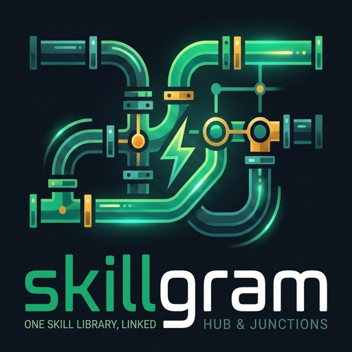

<p align="center"></p>

<p align="center">
  <a href="https://github.com/Xhuk/skillgram/actions/workflows/ci.yml"></a>
  <a href="https://pypi.org/project/skillgram/"></a>
  <a href="https://github.com/Xhuk/skillgram/releases/latest"></a>
  <a href="https://xhuk.github.io/skillgram/"></a>
  
  
</p>

<h1 align="center">skillgram</h1>

<p align="center"><strong>Skill governance for AI agents:</strong> one library, a contract that gates what enters
it, and every coding agent reading the same thing.<br>
Links instead of copies. No drift, and no "which folder does this harness read?".</p>

skillgram is a **registry of `SKILL.md` files** that actually lives in one place on disk, plus the
layer that governs it: a **contract** every skill has to pass (`lint --contract`), **provenance**
for each one (`SKILLMETA.json`: who, when, hash, source), **declared usage** (`touch`, `list`) and a
**ledger** of what has been propagated where. Claude Code, Codex, Cursor, Hermes, Reasonix, Gemini
CLI, OpenCode, Kiro, Qwen Code, Aider, Copilot and anything else that reads skills see the same
library.

Links are the mechanism. Governance is the product.

```
~/.agents/skills/<category>/<skill>/SKILL.md   the hub (the only real copy)
~/.claude/skills/<skill>                       -> junction to the hub (symlink off Windows)
~/.codex/skills/<skill>                        -> junction to the hub
%APPDATA%/Reasonix/skills/<skill>              -> junction to the hub
```

**No work skills are bundled** — it is the plumbing plus the governance, not the content. The only
skill in this repo is [`skills/skillgram-report`](skills/skillgram-report/SKILL.md), which teaches
an agent how to report a bug or a gap.

### The four levers (1.3)

| Lever | Command | What it answers |
|---|---|---|
| **Contract** | `lint --contract`, `new` | does this skill state a trigger, rules, decisions, steps and an output — or is it a paragraph? |
| **Provenance** | `SKILLMETA.json` | who wrote it, when, from where, and the hash that makes `update` possible |
| **Declared usage** | `touch`, `list --used` / `--unused` | which skills were actually used in this project, and which never were |
| **Policy** | per-harness exclude *(planned)*, `retire`, project scope | who is allowed to see this skill, and how it leaves without being deleted |

The honest limit, stated once: skillgram cannot see what an agent *reads*. Usage is what the agent
declares (`skillgram touch` / the `skillgram_touch` MCP tool), and everything built on it says so.

### What this is, in other words

If you were looking for a way to **manage skills for AI agents** — an **admin layer** over the
skills your coding agents load, a **skill registry / skill library / skill manager**, or a way
to share one set of `SKILL.md` files between Claude Code, Codex, Cursor and the rest without
copying anything — this is that tool. Per-project scope, an MCP server so the agent can ask the
hub, links instead of copies, and no LLM in the loop unless you ask for one.

It is **not** a prompt manager, a memory store, or an embeddings index. Those are different
things and there are good tools for them (Engram, for one, is credited below).

## Why

Linking by hand once is easy; keeping fifty agents in sync is not. Agents re-create their own
copies, rename folders, and a new hub skill never shows up by itself. skillgram turns that
into one idempotent command — and with `watch`, into no command at all.

## Install

The whole machine in one idempotent command, plus a copy-paste brief you can hand to a fresh
agent session: **[INSTALL.md](INSTALL.md)**.

```bash
python skillgram.py install --dry-run   # what it would do, nothing written
python skillgram.py install             # harness -> hub -> MCP (delegated) -> propagate
```

```bash
pip install skillgram                  # the command, no clone
```

Or from source, which is what you want if you are changing it:

```bash
git clone https://github.com/Xhuk/skillgram
cd skillgram
python skillgram.py --help
```

Stdlib only (Python 3.9+), no dependencies. Junctions on Windows, symlinks on macOS/Linux.
CI runs the suite on Linux for Python 3.9, 3.11 and 3.13; `release.yml` builds and uploads the
tagged version to [PyPI](https://pypi.org/project/skillgram/).

## Quick start

```bash
skillgram doctor            # what harnesses and native skills exist here (read-only)
skillgram sync              # make the disk match the hub: links only, idempotent
skillgram status            # drift, right now
skillgram install --dry-run # the whole machine: hub + MCP + project scope
```

## How it works

### Links, never copies

`sync` only adds links. It never copies, moves, adopts or deletes a skill an agent already
has: a native skill with the same name as a hub skill is skipped and reported as a collision,
never overwritten. `doctor` tells you how many native skills each harness has before you touch
anything.

For harnesses that scan a single level, each agent also gets one link per category
(`skills/<category>` → `hub/<category>`), so the hub stays browsable.

`precedence` is the cooperative alternative: it declares the hub **first** in each harness'
own config (`skills.paths` for Reasonix, `skills.external_dirs` for Hermes) with a
`*.skillgram-bak-<timestamp>` backup next to the file. Delete skillgram and every harness keeps
exactly what it had.

The hard-mount model — one junction for the whole `skills/` directory — is deliberately *not*
the default: a `rimraf skills` or a harness uninstall would wipe the library of every agent.

### Project scope (engram-style)

The hub is the library; a project is what an agent actually needs while working in it.

```bash
skillgram init my-api                 # <project>/.agents/config.json
skillgram use archify ad3 --project . # link + manifest entry, idempotent
skillgram mount --apply               # materialize that set where each harness looks
skillgram project-status              # healthy / stale / broken / missing links
```

```
<project>/.agents/config.json   {"project_name": "my-api"}
<project>/.agents/skills/<name> link to the hub
<project>/.agents/skills.json   manifest: category, source, hash, promoted_at, last_used
```

Resolution order, same as engram: `--project` → `SKILLGRAM_PROJECT` → nearest
`.agents/config.json` up to the git root → cwd. If it cannot resolve, it says so; it never
guesses. `mount` writes the project's set into every harness layout that reads project-level
skills (`.agents/skills`, `.claude/skills`, `.codex/skills`, `.cursor/skills`,
`.gemini/skills`, `.github/skills`, `.hermes/skills`, `.kiro`, `.qwen`, `.aider`,
`.opencode`), and `--prune-global` goes strict: the harness homes stop seeing the hub at all
(only links that resolve into the hub are removed; native skills stay).

`project-status` also flags a skill that lives both in the hub **and** as a real copy inside
the project.

### The MCP server: let the agent ask

```bash
skillgram mcp               # stdio server, 5 tools
skillgram mcp --read-only   # the agent can query, not use/propose
```

`skillgram_search`, `skillgram_missing`, `skillgram_use`, `skillgram_status`,
`skillgram_propose`. `missing` answering `{"found": false}` is the contract that says *do not
invent a skill, tell the user*. `install` registers this server through each harness' own CLI
and reads the config back afterwards — an exit code is not proof.

### The LLM, only where it earns its place

A connected OpenAI-compatible model is used in exactly three places, always proposing a JSON
plan that skillgram validates and you approve: `bootstrap` (choose a project's initial set from
the repo's signals), `propose` (draft a skill that does not exist) and `port` (translate a skill
wired to another agent into `agents/<harness>.md`). Every decision is stamped `by: llm:<model>`
in the manifest and logged to `~/.agents/skillgram-llm.log`. `--no-llm` and `SKILLGRAM_LLM=off`
turn it off.

```
SKILLGRAM_LLM_BASE_URL   default https://api.deepseek.com/v1
SKILLGRAM_LLM_MODEL      default deepseek-flash
SKILLGRAM_LLM_API_KEY    or DEEPSEEK_API_KEY / OPENAI_API_KEY
```

A project with a scope needs no LLM at all: that is *régime*, where skillgram only serves the
set and answers "do we have something for this?".

### Finding, judging and retiring skills

```bash
skillgram index                                   # FTS5 index of the hub
skillgram search "docker deploy vps" --limit 5
skillgram missing "quote a mortgage"              # found | not found, with candidates
skillgram review --days 90                        # never used / stale
skillgram review --days 30 --fail-if-stale        # CI gate: exit 1 when the set is stale
skillgram pin <skill>...                          # never reported as stale
skillgram retire <skill>                          # -> <hub>/_retired/ + tombstone, never deleted
```

`use` stamps `last_used`, `use_count` and `last_used_by`. `_retired/` keeps the content plus
`_retired.json` (who, when, why, hash) and is never treated as a category.

### Moving a hub around

```bash
skillgram export hub.tar.gz     # every skill + hub.json of hashes
skillgram import hub.tar.gz     # verifies the hashes; --apply to materialize
skillgram diff <skill> --against <path>   # divergence between two copies
skillgram git init --apply      # the hub as a repo (adds a .gitignore for the index)
skillgram git pull --apply      # ff-only: git resolves conflicts, skillgram never guesses
```

The hub is the asset. With git under it, "sync between machines" is git's job.

## What it does NOT do (on purpose)

- It never copies, moves or deletes a native skill. Collisions are reported, not resolved.
- It never edits a harness config by hand: MCP registration goes through that harness' CLI.
- It never guesses which harness is asking (`SKILLGRAM_HARNESS` → `--harness` → process tree →
  `unknown`, and it says so).
- It never publishes a skill nobody approved.
- It is not a memory store, a prompt library, or an embeddings index.

## Safety

- Links only. Dead-link cleanup only touches links that resolve inside the hub — never
  content, never a real directory.
- `onboard` copies and verifies the hash before reporting success; the original only moves to
  `~/.agents/skillgram-quarantine/<harness>/<skill>` with `--replace-natives`, and never to the
  bin.
- Nothing in your repos changes unless you run `init`, `use`, `mount` or `install --root`.
- Preview anything: `install --dry-run`, `sync --dry-run`, `onboard --json --plan plan.json`.

## Report a bug or a gap

Two different things, two different channels — mixing them is how a roadmap turns into noise.
A **gap** (the hub has nothing for a capability) is a *request*: `skillgram_missing` answers
`found:false`, the agent offers `propose`, and the query is recorded in the demand log
(`skillgram demand` ranks what nobody could answer). A **bug** (skillgram itself failed) is one
JSON line with `ok:false` and a non-zero exit — never dressed up as a skill.

The repo ships both forms in `.github/ISSUE_TEMPLATE/` (`bug_report.yml`, `skill_request.yml`)
and the skill that walks an agent through them:
[`skills/skillgram-report`](skills/skillgram-report/SKILL.md).

## Commands

| Command | What it does |
|---|---|
| `doctor` | harnesses, native skills, collisions, dead/missing links. Read-only. |
| `status` / `sync` | drift now / apply the desired state. `--verify`, `--dry-run`. |
| `install` / `propagate` | the whole machine / the repo sweep, with a ledger. |
| `onboard` / `adopt` | consolidate what harnesses already have (LLM optional) / cooperative adoption. |
| `init` / `use` / `unuse` / `mount` / `project-status` | the project scope. |
| `index` / `search` / `missing` / `demand` | find, or learn what is missing. |
| `review` / `pin` / `retire` | lifecycle. |
| `export` / `import` / `diff` / `git` | move a hub around. |
| `mcp` | stdio MCP server, 7 tools (`--read-only` to drop the write ones). |
| `lint` | quality gate: frontmatter, the five contract sections, credentials, placeholders. `--contract` makes the sections mandatory. |
| `new` | scaffold a skill from the contract (`SKILL.md` + `SKILLMETA.json`); `lint` decides whether it ships. |
| `watch` / `daemon` / `install-autostart` | keep it in sync by itself. |

`skillgram --help` lists all of them (37); `skillgram <command> --help` is the contract for
one. Every command prints **exactly one JSON line** on stdout (`--json` for the human ones too).
Exit code `0` healthy, `1` drift/error, `2` bad invocation.

## Authoring a skill: one contract, one gate (1.3)

Three doors, the same gate — `lint`. The normative text is
[docs/SKILL-CONTRACT.md](docs/SKILL-CONTRACT.md).

```bash
skillgram new my-skill --category infra-ops   # scaffold + SKILLMETA.json, does not publish
skillgram lint my-skill --contract            # fails while a TODO is left
skillgram propose "<need>" --apply            # the LLM drafts it; the same gate checks it
skillgram lint --contract --strict            # the whole hub, warnings included (what CI should run)
```

Every authored skill declares the same five sections — *Activation Contract* (when it applies and
when it does not), *Hard Rules*, *Decision Gates*, *Execution Steps*, *Output Contract* — and
carries a `SKILLMETA.json` with who wrote it, when, and the content hash. Without that hash there
is no `update` later, only overwrite.

```json
{"ok":true,"op":"status","version":"1.4.0","hub":"C:\\Users\\me\\.agents\\skills","skills":842,"categories":18,"nested":12,"agents":50,"drift":0,"watching":false,"missing":0,"mispointed":0,"dead":0,"skipped":2}
```

## Known gaps (documented, not implemented)

Compared with Engram (Gentleman-Programming), which is a service with a full lifecycle, these
remain open by decision. When one closes, the line goes away.

1. **No cross-machine sync.** `export`/`import` is manual; there is no transport and no
   conflict resolution between two hubs. (`git` under the hub is the workaround.)
2. **No merge of divergent skills.** Same name + different content fails; the merge is a human
   (or LLM) decision, then `diff` tells you exactly what differs.
3. **No real usage telemetry.** `use_count` counts explicit promotions and MCP `use` calls;
   skillgram does not observe which skills an agent actually reads.
4. **Lexical search only.** FTS5 has no embeddings, so cross-language synonyms miss (measured:
   `"cotizar credito hipotecario"` → one weak hit).
5. **No permissions/profiles.** No agent/admin split: anyone with a shell can publish or
   retire. `mcp --read-only` removes the write tools from a session, but it is a per-server
   switch, not a role.
6. **No taste gate.** `lint` checks shape and is a hard gate in `propose`, but nothing judges
   whether a skill is *useful*: no eval, no grading, no dry run of the skill itself.
7. **No scheduled review.** `review` is manual; put `review --fail-if-stale` in your cron/CI.
8. **MCP is tools-only.** No `resources`, no `prompts`, no sampling.

## Language

Everything user-facing is **English**: CLI output, error messages and every JSON key
(`promoted`, `already_present`, `missing_links`, `native`, `collisions`, `signals`,
`selection`, ...). That is the API other tools read. Internal code comments and docstrings are
still partly Spanish; translating them is tracked as cleanup, not as behaviour.

## Prior art and credits

skillgram is original code (MIT, stdlib only), but the ideas are not mine and pretending
otherwise would be dishonest. These shaped it — if one of them is what you actually need, use
it directly:

- **Engram** — the project-scope resolution order (`--project` → env → nearest
  `.agents/config.json` up to the git root → cwd), the "one store, a per-project view" model,
  and the CLI-plus-MCP split this repo copied the shape of.
- **Agent Skills / `SKILL.md`** (Claude Code, then everyone else) — the `SKILL.md` + YAML
  frontmatter format and the `.claude/skills` convention every other harness imitated.
  skillgram does not invent a format: it links yours.
- **Codex, Cursor, Gemini CLI, Kiro, Qwen Code, Aider, OpenCode, Copilot** — their
  project-level `skills/` layouts are the reason `mount` knows eleven of them.
- **ECC** — a 291-skill pack that lives next to this hub, and the reason every feature here is
  tested against "does this still hold at ~850 skills?".
- **Unix**, in the only sense that matters: one directory is the truth, every agent a client.

No code was copied from any of them. Where a behaviour was learned from another tool, the
section that documents it says so. If your project belongs in this list, open an issue — credit
is cheap, respect is not.

## Where the detail lives

| You want | Read |
|---|---|
| to install on a machine, or hand it to an agent | [INSTALL.md](INSTALL.md) |
| what changed, version by version | [CHANGELOG.md](CHANGELOG.md) |
| the install flow as a diagram | [docs/diagrams/skillgram-install.html](docs/diagrams/skillgram-install.html) |
| the rules this repo holds itself to | [AGENTS.md](AGENTS.md) |
| what a skill must contain | [docs/SKILL-CONTRACT.md](docs/SKILL-CONTRACT.md) |
| how to report something | [skills/skillgram-report](skills/skillgram-report/SKILL.md) |

## Tests

```bash
python -m unittest discover -s tests -v
```

## License

MIT.
